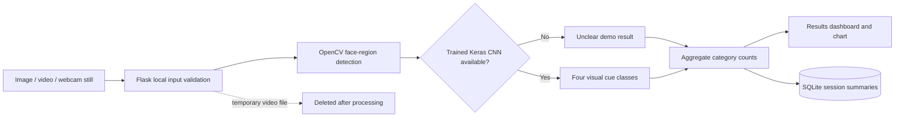

# Smart Classroom Attention Detection Using Deep Learning and Computer Vision

A local-first college mini-project that detects visible face regions and summarizes approximate visual cues in classroom images or sampled video frames. It does **not** measure mental attention, emotion, participation, comprehension, learning, or student performance. Labels are only image-based indicators and may be wrong.

## What is included

- Flask dashboard for image/video upload, a single webcam capture, results, session history, CSV export, and session deletion.
- OpenCV frontal/profile Haar cascades for lightweight face-region detection. Identifiers are temporary per-frame labels; there is no face recognition or cross-frame identity tracking.
- A small TensorFlow/Keras CNN training and inference path for four classes: `facing_forward`, `looking_away`, `head_down`, and `unclear`.
- Honest no-model behavior: detected regions are labeled **Unclear** with a demo source label until a trained checkpoint is present. There are no fabricated weights, training metrics, or bundled student photos.
- SQLite stores aggregate counts, input type, timestamp, and model mode. Uploaded files are temporary; videos are deleted after processing and images are not saved. Processed previews are returned in the response, not stored in the database.
- A simulated sample dashboard at `/sample` that works without a webcam or dataset. Its illustration and counts are explicitly mock data and are never saved as a session.
- A labeled-data splitter, CNN training script, optional test-set classification report and confusion matrix, and focused Flask tests.

The Bootstrap assets are served locally by Bootstrap-Flask. The results distribution chart is HTML/CSS, and Matplotlib is used for the optional training confusion matrix. The app requires no cloud API or external inference service.

## Requirements

- Windows 10/11, 64-bit
- Python 3.10 recommended (the pinned TensorFlow release has native Windows wheels for this setup)
- A standard CPU laptop; no GPU is required
- Webcam is optional

Python 3.13 is not the documented training environment for these pinned TensorFlow dependencies. Install Python 3.10 from python.org and enable the Python launcher (`py`) during installation if it is not already available.

## Install and run on Windows

Open PowerShell in the project folder:

```powershell
py -3.10 -m venv .venv
.\.venv\Scripts\Activate.ps1
python -m pip install --upgrade pip
python -m pip install -r requirements.txt
python app.py
```

Open `http://127.0.0.1:5000`. If PowerShell blocks activation, run the environment interpreter directly instead:

```powershell
.\.venv\Scripts\python.exe -m pip install -r requirements.txt
.\.venv\Scripts\python.exe app.py
```

Keep the development server on localhost. Flask's built-in server is for a college prototype, not public deployment.

## Step-by-step demonstration

1. Start the server using the commands above.
2. Open **Open simulated sample** from the overview. It shows a generated classroom illustration and fixed illustrative counts; they are not model outputs and are not saved.
3. Open **Analyze media** and upload a permitted classroom photo or short video. Alternatively, select **Start webcam**, allow camera access, and capture one still frame.
4. Review the annotated image and category distribution. With no trained model, any detected face boxes show **Unclear** and the results identify demo mode. No face detected is not evidence of any behavior.
5. Open **Sessions** to review aggregate summaries, export CSV, or delete a summary. No source media or face crops appear in history.
6. To demonstrate CNN predictions, prepare an appropriately labeled dataset, train a model as described below, restart the app, and repeat the analysis. Do not present a model as validated unless you report its real held-out test results and dataset limitations.

### Expected output

For the built-in simulated preview, the dashboard displays six synthetic illustration markers with example counts (two facing-forward, one looking-away, one head-down, two unclear). Those numbers are fixed demo content, not detection or evaluation results.

For a real upload before training, OpenCV may draw a box around each detected face region. Each detected box is labeled **Unclear** with `0%` demo confidence because no trained classifier is available. Face detection can also return zero boxes. After training, the source changes to `trained CNN`; a maximum class probability below `0.55` becomes **Unclear**. The displayed confidence and label are still fallible estimates, not calibrated probabilities.

Video analysis samples approximately one frame per second, for up to 300 frames. The `face observations` count is summed across sampled frames; it is not a count of distinct students. The detected-subject metric is the largest count in any sampled frame.

## Dataset and training

There is no public dataset download, pretrained model, or generated training dataset included. The splitter expects permission-cleared, manually labeled **face crops**, with folder names exactly matching the four classes. See [dataset/README.md](dataset/README.md).

```powershell
python prepare_dataset.py
python train.py --epochs 20 --batch-size 16
```

The preparation script makes deterministic train/validation/test copies (70/15/15 by default) and requires at least three readable images per class to keep each split non-empty. This minimum only enables execution; it does not produce a reliable model. Keep related subjects or recording sessions together in one split to reduce leakage. The CNN uses 96×96 RGB inputs, light augmentation, early stopping, and a small batch size for CPU use. The saved model is `models/attention_cue_cnn.keras`.

Training writes actual run metrics to `results/training_report.json`. If all four labeled test folders are present, it evaluates that test split and writes per-class precision/recall/F1, overall accuracy, a confusion matrix in JSON, and `results/confusion_matrix.png`. No report is created by the demo path. Do not compare scores from different datasets as if they shared the same difficulty.

## Testing and evaluation

Run the app and data-path tests:

```powershell
python -m pytest -q
```

The tests cover an image upload, video-route processing and temporary-file cleanup, no-model classification fallback, dashboard category totals, CSV export, and deletion. Training/evaluation requires a labeled dataset and is intentionally not part of the fast test suite.

Metric meanings:

- **Accuracy**: fraction of test examples whose class was predicted correctly; it can hide poor performance on rare classes.
- **Precision**: among examples predicted as a class, the fraction that truly belong to it.
- **Recall**: among examples truly in a class, the fraction correctly found.
- **F1-score**: harmonic mean of precision and recall; useful when both missed and false predictions matter.
- **Confusion matrix**: counts true classes against predicted classes, making class-specific confusions visible.

Basic performance procedure: use the same fixed held-out test split; record CPU model, Python/TensorFlow versions, input resolution, video sample interval, and number of images/frames; run one warm-up and at least five timed runs; report median processing time and frames per second along with macro-F1 and per-class metrics. Record zero-face and uncertain outcomes too. Do not report a score or speed until measured on the target machine.

## Troubleshooting

- **`py -3.10` is not found:** install 64-bit Python 3.10 and select the Python launcher option, or invoke the installed 3.10 executable directly.
- **TensorFlow has no compatible wheel:** confirm the active venv is 64-bit Python 3.10 or 3.11 and use the pinned requirements. Do not install TensorFlow into the workspace's unrelated Python 3.13 environment.
- **OpenCV import or cascade error:** activate the venv, reinstall `opencv-python` from `requirements.txt`, and avoid installing both `opencv-python` and `opencv-python-headless` into the same environment.
- **Camera access fails:** webcam capture works in a browser on `localhost` or HTTPS. Check OS/browser permission; file upload and the simulated sample do not need a camera.
- **Video cannot open:** try a short MP4/AVI with a codec supported by the local OpenCV build; some phone MOV/HEVC formats need conversion to H.264 MP4.
- **No faces or all cues are unclear:** small, turned, occluded, dim, or low-resolution faces can be missed. A trained CNN is required for non-demo classes, and it must be trained on suitable labeled crops.
- **Training is slow or runs out of memory:** lower `--batch-size` (for example, 8), reduce image collection size, or lower epochs. Keep the CPU thread settings in `train.py`.
- **PowerShell refuses venv activation:** use `.\.venv\Scripts\python.exe` directly as shown above.

## Privacy and responsible use

Keep media local and use consented, permission-cleared material. The app does not identify people. Temporary video files are deleted even when video processing raises an error; database rows retain only aggregate cue counts, media type, timestamp, peak frame count, observation count, and model mode. Delete summaries from the Sessions page when no longer needed. Browser webcam capture transfers a single captured frame to the local Flask server for processing; it does not send audio or stream video to the server.

These categories are approximate visible cues only. Camera angle, lighting, distance, occlusion, face visibility, pose, and individual differences can affect outputs. Do not use the results for grading, attendance, discipline, ranking, or decisions about an individual student.

## College report material

### Abstract

This mini-project presents a local prototype for detecting visible face regions in classroom media and summarizing approximate orientation cues. OpenCV Haar cascades provide lightweight face detection, while an optional compact TensorFlow/Keras convolutional neural network classifies face crops into facing-forward, looking-away, head-down, and unclear categories. A Flask dashboard supports still images, sampled videos, a single webcam frame, session-level charts, and CSV export. SQLite stores aggregate counts rather than source media or identity information. Without a trained model, detections remain explicitly marked unclear. The outputs describe image cues only and are not a measure of attention, learning, or student performance.

### Objectives

- Build a CPU-friendly, local media-analysis prototype with image, video, and optional webcam input.
- Detect multiple visible face regions and assign temporary per-frame labels without recognizing identities.
- Provide a trainable CNN pipeline, uncertainty threshold, aggregate summaries, and held-out test metrics when labeled data exists.
- Demonstrate privacy-conscious handling by deleting temporary video files and retaining only aggregate session metadata.

### Methodology

Media is decoded locally. OpenCV frontal/profile Haar cascades produce face-region boxes. Each crop is resized to 96×96 RGB and normalized. If a trained four-class CNN exists, its maximum softmax score is compared with a 0.55 uncertainty threshold; otherwise the result is explicitly the untrained demo fallback. Video frames are sampled at approximately one-second intervals. Counts are aggregated across face observations, shown in a Flask dashboard, and written to SQLite without storing the media. Optional training uses labeled folders, deterministic splits, augmentation, early stopping, and a held-out test report.

### Advantages

- Runs locally without paid APIs, cloud inference, or GPU hardware.
- Demonstrates an end-to-end computer-vision, deep-learning, database, and web workflow.
- Provides a working interface before model training while clearly distinguishing simulation/demo output from trained-model output.
- Stores summaries rather than source images and supports session deletion and CSV export.

### Limitations

- Haar cascades can miss faces and do not robustly detect head pose; the four cue classes need a representative, carefully labeled dataset to be useful.
- Model output can be biased or unreliable under changes in camera placement, light, distance, occlusion, pose, and population.
- A softmax score is not calibrated confidence. The 0.55 threshold is an uncertainty rule, not a validated safety guarantee.
- Video summaries count repeated frame observations, not unique subjects; no identity or cross-frame tracking is attempted.
- Visual orientation cannot establish mental attention, understanding, or learning.

### Future enhancements

- Evaluate a pose-aware detector and an independently reviewed, consented dataset with subject/session-separated splits.
- Calibrate uncertainty thresholds and report confidence intervals and per-condition errors.
- Add opt-in retention controls, role-based access, and auditable deletion if moving beyond a local prototype.
- Improve accessibility, low-light handling, and evaluation across camera positions without making individual-level claims.

## Architecture

